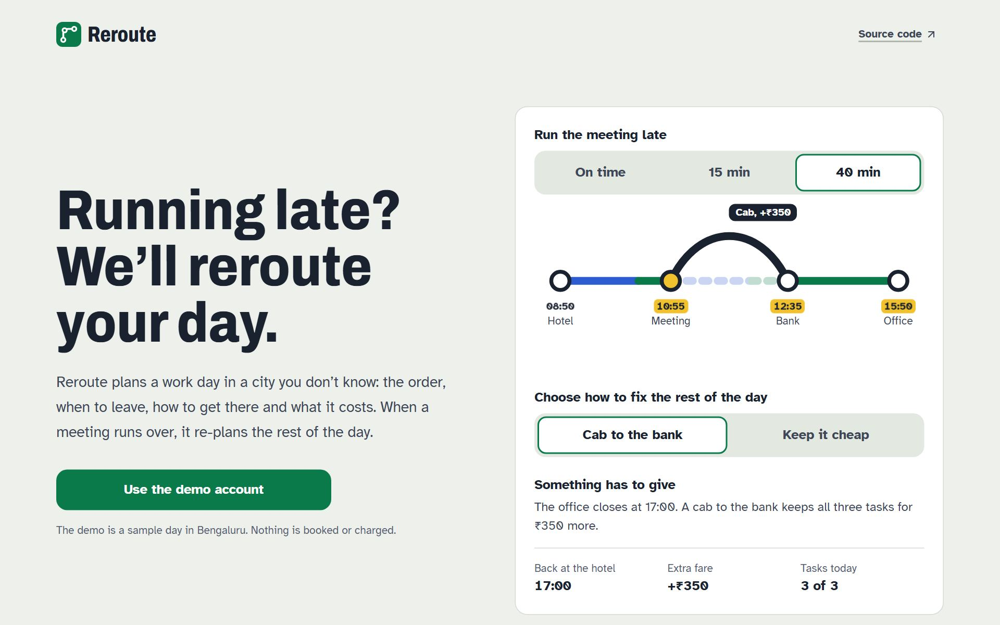
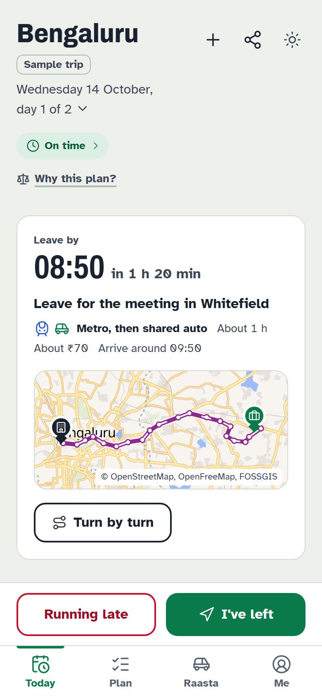
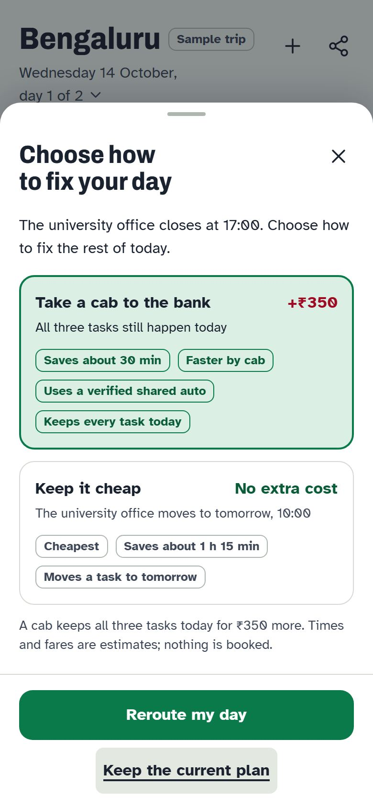
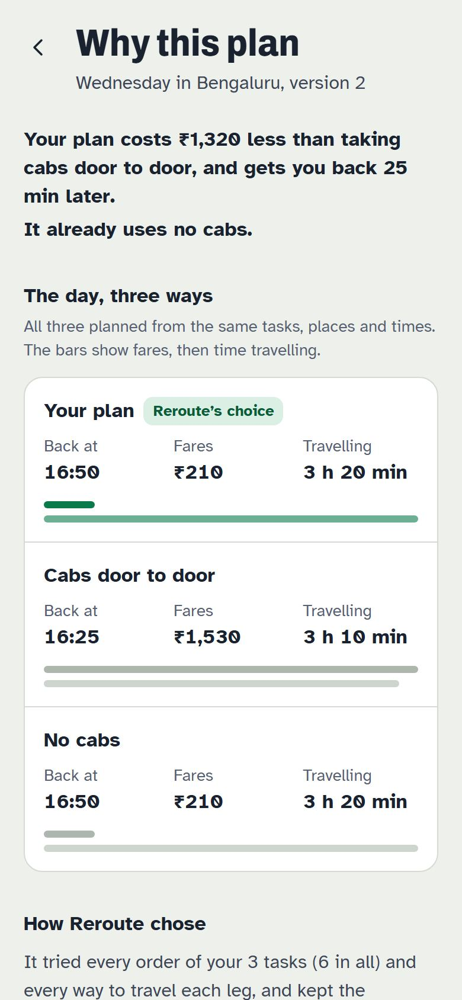
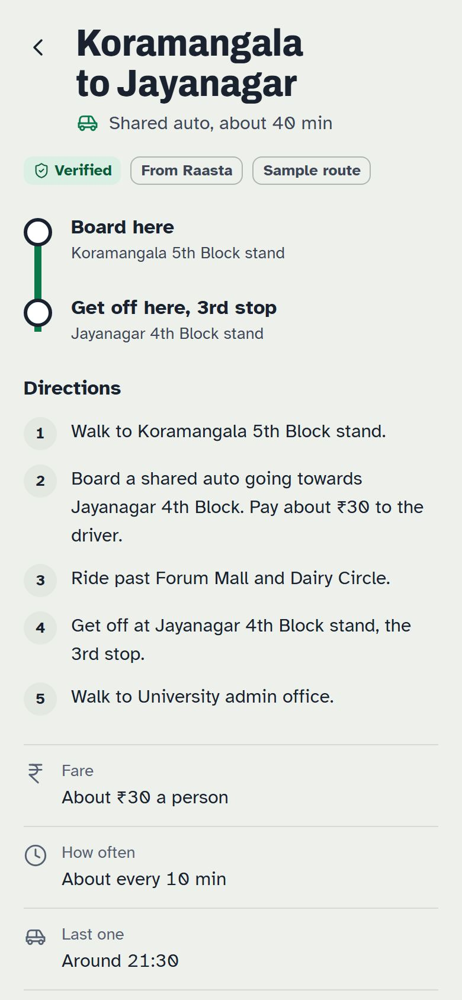
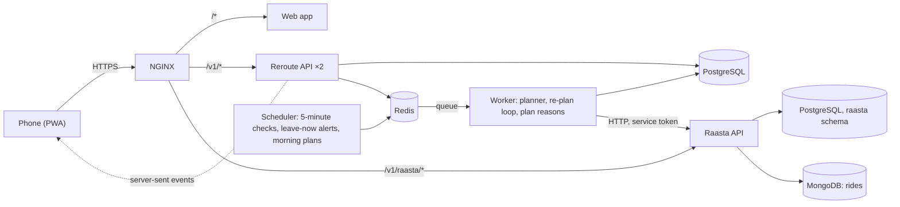

# Reroute

> Intelligent, resilient trip planning for work travel across Indian cities.

[](https://github.com/Dikshaa16/REROUTE/actions/workflows/ci.yml)

<picture>
  <source media="(prefers-color-scheme: dark)" srcset="docs/images/landing-dark.jpg">
  
</picture>

Reroute is a travel companion for work trips in unfamiliar Indian cities. Add your appointments, locations, opening hours, and constraints once; Reroute determines the best order, departure times, transport options, and estimated cost for each leg. It then tracks the day with you and responds to delays by recalculating the remaining itinerary.

When a delay can be absorbed, Reroute adjusts the schedule automatically. When a trade-off is required, it preserves fixed commitments and presents clear, explainable alternatives so you remain in control.

**Raasta**, the integrated transit module, is a crowdsourced and moderated map of shared-auto, e-rickshaw, and tempo routes. It records stops, fares, service frequency, and the final departure of the day. Reroute uses verified Raasta routes when planning local journeys.

> Travel times and fares are estimates. Demonstration data is representative sample data.

<table>
  <tr>
    <td width="25%"><picture><source media="(prefers-color-scheme: dark)" srcset="frontend/public/landing/today-dark.jpg"></picture></td>
    <td width="25%"><picture><source media="(prefers-color-scheme: dark)" srcset="docs/images/options-dark.jpg"></picture></td>
    <td width="25%"><picture><source media="(prefers-color-scheme: dark)" srcset="frontend/public/landing/why-dark.jpg"></picture></td>
    <td width="25%"><picture><source media="(prefers-color-scheme: dark)" srcset="frontend/public/landing/raasta-dark.jpg"></picture></td>
  </tr>
  <tr>
    <td>The day as a transit line</td>
    <td>40 minutes late: you choose</td>
    <td>Why this plan?</td>
    <td>A verified shared auto</td>
  </tr>
</table>

## Key capabilities

- **Deterministic trip planning.** The planner (`backend/app/services/planner/`) is a pure function: tasks, opening hours, fixed times, and travel options go in; a complete plan comes out. It has no dependency on the clock, network, or database, and searches every order up to eight tasks using branch and bound.
- **Explainable delay recovery.** Small delays can shift later stops automatically. Larger delays preserve fixed commitments and present two or three explained alternatives, such as changing transport or moving a flexible task to another day.
- **Fixed commitments are protected.** Meetings and other fixed-time activities are never silently moved. If arrival is no longer possible, Reroute keeps the commitment intact and plans the remainder of the day from the actual arrival time.
- **Transparent decisions.** “Why this plan?” compares the selected itinerary with alternatives, shows the available travel options for each leg, and indicates whether the order search was exact.
- **Asynchronous architecture.** The API saves and queues work; an RQ worker performs planning and re-planning. Immutable plan versions make undo reliable, while a scheduler checks trips, raises departure alerts, and prepares multi-day itineraries.
- **Resilient offline experience.** The installable PWA caches the day, queues offline check-ins, replays them with idempotency keys, and receives live updates through reconnecting server-sent events.
- **Secure accounts and guided setup.** Users can register with email and password or Google authentication. New users are guided through their first trip by Rico, the in-app assistant.
- **A wallet, flights and connected services, all simulated.** Cab, train and flight bookings through invented partners (RideNow, AutoGo, ZipBike, RailGo, SkyHop) are paid from a wallet of pretend money, and a short balance says how much to add.
- **Talk to Rico.** Say "I'm 20 minutes late" and Running late opens with 20 filled in; "done", "I've left" and "what's next" work too. Plain patterns, no AI, and nothing changes without your last tap.
- **Rico in 3D everywhere, lips in time with its voice.** Rico is a plush sprout rendered in Blender (real fur, felt cheeks, a stitched face) and drawn live with WebGL: it breathes, blinks, follows your pointer and hops as it speaks, and its felt mouth takes the shape of each sound it says, timed from the voice service's word timings and the clip's loudness. Beside each of its lines in the chat, and on devices that don't draw 3D well, a still of the same 3D Rico stands in, so Rico is never flat. Lines play one after another, never cutting each other off.
- **Talk to Rico out loud** (with the AI helper and a Gemini key). The green voice button in the chat (where Send is while the box is empty) brings Rico up full screen for a real conversation, like ChatGPT's voice mode with Rico in place of its orb: a glow round him breathes while he listens, rings with your voice as you speak, turns while he thinks and pulses with his voice. He hears when you stop and answers within a fifth of a second (Gemini 3.8 Live), and stops when you talk over him; captions only if you turn them on. Ask him to change the day and the change comes up on his card, as in the chat. In the Android app, say yes when Rico offers **"Hey Rico"** as the app opens (or turn it on in Me) and say his name: he pops up talking, even with Reroute closed if you let him listen in the background; with **Pop up over other apps** on, he appears over whatever app you're in and opens talking, like a voice assistant. The words are heard on the phone itself.
- **Rico as your local guide** (with the AI helper and a Gemini key). New in a city? Tap the glasses in Rico's chat and he puts his guide glasses on: he asks whether to recommend places or follow yours, recommends real ones from Wikivoyage, OpenStreetMap and the web, and offers to plan your whole day, tickets and all (simulated entry tickets from SightPass, which show in your bookings).
- **Rico walks with you.** A small Rico wanders along the bottom of the screens, naps when left alone and giggles when tapped. Before a leg on roads that are usually busy, or when you're running behind, he pops up with "Hi, are you there? 👋", and answering has him say why and offer to move the plan.
- **Rico does it for you** (with the AI helper and a Gemini key). Ask for several things at once ("skip the university office, book a cab to the bank and go dark") and Rico reads your day, the rides and your wallet, then puts every change on one card: *Rico will do 3 things*. Nothing changes until you tap **Do all**; each step then shows how it went, and **Undo** takes the card back. Rico works through the app's own API, signed in as you, so it can do exactly what you can and no more.
- **Real roads, turn by turn.** Every leg is drawn along OpenStreetMap's roads (from FOSSGIS's routing servers), a metro ride station to station along its line, a shared auto along its recorded path or the roads through its stands. A stretch nothing can place is a dashed line marked approximate, never a made-up road. **Turn by turn** gives the next instruction large, every step in order and the map following you, speaks the turns in the phone's own voice, and says when you've left the route. **Open in Google Maps** hands the same leg to Google.
- **A second service with its own rules.** Raasta trims the ends of every recorded ride for privacy, verifies a route only with a moderator or two different riders, lets routes go stale, and serves Reroute over HTTP with a service token: the database roles make reading its tables from Reroute impossible.
- **Accessible in both themes.** Playwright runs axe on every screen at phone and desktop sizes, in light and in dark; targets are at least 48 px, and motion follows the reduced-motion setting.

Every choice that departs from the briefs is logged with its reason in [docs/decisions.md](docs/decisions.md).

## Quick start

You need Git and Docker Desktop.

```bash
git clone https://github.com/Dikshaa16/REROUTE.git
cd Reroute
docker compose up --build
```

Open **https://localhost**, accept the local certificate, and choose **Create account**: Rico meets you and sets up your first trip.

To try the prepared demo day (and its **Simulate** panel), add `DEMO_LOGIN=true` to the `.env` file at the repository root and run `docker compose up -d`; **Use the demo account** then appears under the sign-in options.

If ports are taken on your machine, the stack stays out of the way: PostgreSQL, Redis and MongoDB are published on 55432, 56379 and 57017, and plain HTTP on 8080. Change any of them with `POSTGRES_HOST_PORT`, `REDIS_HOST_PORT`, `MONGO_HOST_PORT`, `HTTP_PORT` or `HTTPS_PORT`. Everything listens on 127.0.0.1 only; set `BIND_ADDR=0.0.0.0` to try the app from a phone on the same network. Browsers won't install the offline service worker over an untrusted certificate; to try offline mode locally, trust the certificate (for example with [mkcert](https://github.com/FiloSottile/mkcert), placed at `/etc/nginx/certs/localhost.{crt,key}` in the `certs` volume). The demo trip is Bengaluru, Wednesday 14 October 2026, on a simulated clock.

Try the golden path:

1. **Plan** → **Plan my day**. The plan leaves the hotel at 08:50; the meeting is 10:00 to 11:00, the bank 12:25, the university office 15:40, back at the hotel 16:50.
2. Open the **Simulate** panel, set the time to 10:55, then **Running late** → **About 15 min**. Everything still fits, so Reroute shifts the later stops (12:40, 15:55, 17:05) without asking.
3. Undo it, then report **About 40 min**. Now something must give: **Take a cab to the bank** (+₹350, saves 30 min) or **Keep it cheap** (the office moves to tomorrow at 10:00). Choose one, then Undo.
4. On Today, tap **Why this plan?** to see the day planned three ways and every option for each leg.
5. Tap Rico on the Now line, then **Talk to Rico**, and say "what's next" (Chrome or Edge; the browser asks for the microphone once).
6. **Share** your trip and open the link in a private window: family see your stops and progress, never your exact location.

## How it fits together



- The **planner** is a pure function (`backend/app/services/planner/`): inputs in, plan out, no clock, network or database. Up to eight tasks the search is exact.
- The **API never plans inside a request**: it saves, enqueues, and the worker plans. Plans are immutable versions; Undo reactivates an earlier one.
- **Reroute reaches Raasta only over HTTP** through the transit adapter. The database roles make reading Raasta's tables impossible.
- Live updates go to the phone as server-sent events.

## Repository

| Path | What |
|---|---|
| `backend/` | Reroute API, worker and scheduler (FastAPI, SQLAlchemy, RQ) |
| `raasta/` | Raasta API (FastAPI, PostGIS, MongoDB) |
| `frontend/` | The web app (React, Vite, TypeScript, PWA); `frontend/android` is the same app for Android (Capacitor) |
| `shared/contracts/` | Generated OpenAPI files: the contract |
| `examples/bengaluru/` | Sample demo trip, travel times and Raasta routes |
| `examples/india-cities.json` | Where each city on Reroute's list is, its centre and area, from OpenStreetMap (ODbL) |
| `postman/` | API collection with response examples |
| `tests/load/` | k6 load test |
| `infra/` | NGINX, PostgreSQL roles, OSRM preparation, and the scripts that fetch the city list and the metro lines from OpenStreetMap |
| `docs/` | [API guide](docs/api-guide.md), [testing guide](docs/testing-guide.md), [decisions](docs/decisions.md), [data and privacy](docs/data-and-privacy.md), [known limits](docs/known-limits.md), [briefs](docs/briefs/) |

## Working outside Docker

Node.js 22 (LTS) and Python 3.12 are only needed here.

```bash
# Databases only (published on 55432, 56379 and 57017 so they don't clash with local installs)
docker compose up -d postgres redis mongo

# Reroute API (http://localhost:8000/v1/docs)
cd backend && python -m venv .venv && . .venv/bin/activate   # Windows: .venv\Scripts\activate
pip install -e ".[dev]" && cp .env.example .env
alembic upgrade head && python -m app.seed
uvicorn app.main:app --reload            # and in other shells: rq worker planning; python -m app.workers.scheduler

# Raasta API (http://localhost:8001/v1/raasta/docs)
cd raasta && pip install -e ".[dev]" && cp .env.example .env && alembic upgrade head && python -m app.seed && uvicorn app.main:app --port 8001

# Web app (http://localhost:5173)
cd frontend && pnpm install && pnpm dev
```

## The Android app

The same React app also runs as an Android app (`frontend/android`, made with [Capacitor](https://capacitorjs.com) 8). Every screen is the web app's own; where Android's web view lacks a browser feature, Android supplies it: Google sign-in, talking to Rico, the phone's voice, notifications, sharing and saving the expense slip. One thing is the app's alone: listening for "Hey Rico". The browser build is unchanged. You need [Android Studio](https://developer.android.com/studio) (Otter 2025.2 or newer, with Android SDK 36) and JDK 21; Node.js 22 builds the web part.

1. Start the stack as in [Quick start](#quick-start). For a phone on the same Wi-Fi, also set `BIND_ADDR=0.0.0.0`. The API lets the app's origin in through `CORS_ORIGINS` (`https://localhost` by default).
2. Tell the app where the API is:

   ```bash
   cd frontend
   cp .env.android.example .env.android
   ```

   In `.env.android`, `VITE_API_BASE` is `https://10.0.2.2` for the emulator (its name for your PC), `https://<your PC's Wi-Fi address>` for a phone, or the real host for a release. For Google sign-in, set `VITE_GOOGLE_CLIENT_ID` to the server's `GOOGLE_CLIENT_ID`.
3. Build the web part into the Android project, then the app:

   ```bash
   pnpm build:android
   ```

   ```bash
   cd android && ./gradlew assembleDebug
   ```

   The APK is `frontend/android/app/build/outputs/apk/debug/app-debug.apk`; `adb install -r` it, or run `pnpm android:open` and press Run in Android Studio.

- **Checking it against the web app.** With the debug APK installed and the emulator (or a phone) on `adb`, `frontend/e2e-android` walks the same journeys as the browser tests inside the app's own web view, and fails on any console error or any error in the app's own Logcat: `pnpm exec playwright test -c playwright.android.config.ts`. The stack the APK was built for must be running, with `DEMO_LOGIN=true`.
- **Talking to the emulator.** The emulator's microphone hears your PC's only with host audio input on: `adb emu avd hostmicon` (or Extended controls → Microphone → "Virtual microphone uses host audio input"), again after each start. Without it, "Hey Rico" and voice mode hear silence.
- **Certificates.** Debug builds accept the local stack's self-signed certificate on loopback and private-network addresses only; release builds check every certificate.
- **Google sign-in** in the app needs an Android OAuth client in the same Google Cloud project as the web client: package `com.reroute.app` and the SHA-1 of the key that signs the APK (`cd frontend/android && ./gradlew signingReport` shows the debug key's). Adding the app to Firebase with that SHA-1 (below) creates it.
- **Releasing** needs an upload key (Android Studio → Build → Generate Signed App Bundle), its SHA-1 on the Android OAuth client, and a Google Play developer account to publish.

### Push notifications

Android cuts an app's network a few seconds after it leaves the screen, so the live stream can't reach a phone in the background. With Firebase set up, the server also sends each leave-by alert (10 minutes before and at the time) and the morning plan as a push, and the app shows it even when Android has frozen it. Firebase is free for this.

1. In the [Firebase console](https://console.firebase.google.com), add Firebase to the Google Cloud project that holds the web sign-in client (**Create a project** → **Add Firebase to a Google Cloud project**). Analytics isn't needed.
2. **Add app** → **Android**: package `com.reroute.app`, and the SHA-1 of the signing key. Download `google-services.json` into `frontend/android/app/` (it's ignored by git), then build the app again.
3. In Google Cloud console → **IAM & Admin** → **Service accounts**, create one with only the role **Firebase Cloud Messaging API Admin**, and give it a JSON key. Keep it outside the repository, set `FCM_SERVICE_ACCOUNT` to its path in the `.env` next to `docker-compose.yml`, and run `docker compose up -d` again: only the worker gets the key, as a Compose secret, and the API is told push is on (`FCM_CREDENTIALS_FILE` when running the API without Compose). After switching to a new key file later, `docker compose up -d --force-recreate worker`.
4. In the app, turn on **Me → Phone notifications**. The phone registers with the server, and the switch then says alerts arrive after Reroute is closed; turning them off, or signing out, takes it off again. If it never says so, the worker's log tells why (`docker compose logs worker`, "no usable Firebase key"): most often `google-services.json` given in place of the server's key, or a key file the container's user can't read.

With only one of the two files, or neither, nothing is pushed and alerts work as before: the app still shows its own notifications from the live stream, while it's open or briefly in the background.

What differs from the browser, and why, is in [decisions](docs/decisions.md#the-android-app-24-october-2026); what isn't done yet is in [known limits](docs/known-limits.md#the-android-app).

## Tests

| Suite | Size | Command |
|---|---|---|
| Reroute API and planner | 341 tests (the API flow tests need `TEST_DATABASE_URL` pointing at PostGIS) | `cd backend && pytest` |
| Raasta | 110 tests | `cd raasta && pytest` |
| Web app, and the Android app's own pieces | 330 tests | `cd frontend && pnpm test` |
| The demo day over HTTP | 32 requests, 54 assertions | `npx newman run postman/reroute.postman_collection.json --insecure` |
| End to end with axe | 62 tests, phone and desktop | `cd frontend && E2E_BASE_URL=https://localhost pnpm e2e` |
| The Android app against the web app | 22 tests on an emulator or phone, with its console and Logcat; a 23rd with Firebase set up (`PUSH_E2E=1`): an alert reaching a frozen app as a push; and a 24th (`WAKE_E2E=1`, a debug build, and the internet for Rico's speech model): recorded voices saying "hey Rico" wake him on screen and in the background, sound-alikes don't, and Reroute carries on if Rico's ear dies | `cd frontend && pnpm exec playwright test -c playwright.android.config.ts` |
| Load | 500 virtual users, 95% under 500 ms | `k6 run tests/load/k6.js` |

CI runs all of them except the load test, which runs on demand, and the Android app's, which needs an emulator or a phone. It also fails if either API's OpenAPI file drifts from `shared/contracts/`.

To test by hand, feature by feature (and with a real Google account), follow [docs/testing-guide.md](docs/testing-guide.md).

## Configuration

Every setting is an environment variable documented in `backend/.env.example`, `raasta/.env.example` and `frontend/.env.example`. No secret is committed or sent to the browser. `DEMO_LOGIN` (off unless set) turns on the demo account; `SIMULATED_SERVICES` (on by default, off in `docker-compose.prod.yml`) turns on the simulated bookings, wallet and connected partners for every account. `DEMO_LOGIN=true` is refused when `APP_ENV=production`, and so are development values of `JWT_SECRET` and `RAASTA_SERVICE_TOKEN`.

For a deployment, `docker compose -f docker-compose.yml -f docker-compose.prod.yml up -d --build` runs everything in production mode without the demo login; Compose refuses to start until every secret it names is set.

## Team

| Owner | Area |
|---|---|
| Ankit | Backend and the agentic flow: the APIs, planner, re-plan loop and worker |
| Diksha Sharma | Databases and AI: schemas, migrations, PostGIS and MongoDB, Redis, seed and Raasta data, the optional AI helper |
| Trish | Frontend: the React PWA, following the UI brief |
| Lovish | Testing and deployment: pytest, Postman and Newman, k6, Playwright with axe, Docker, NGINX, CI |
